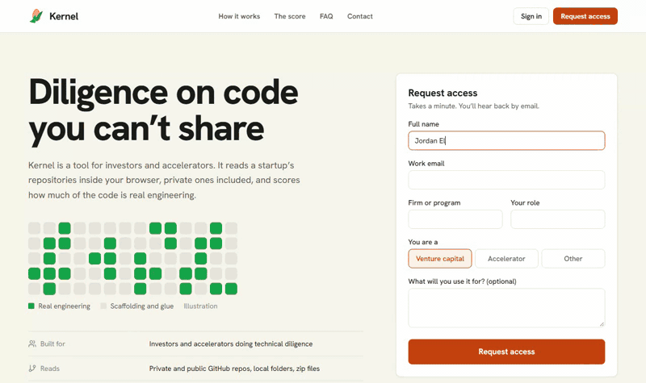
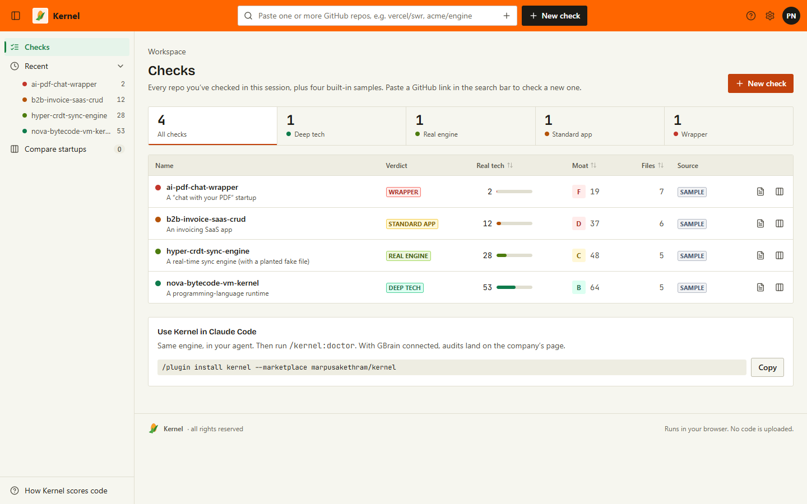
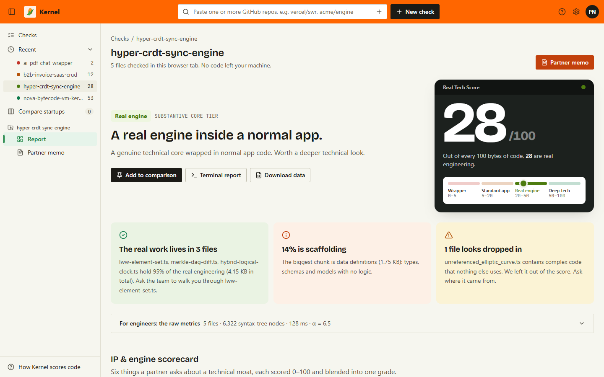
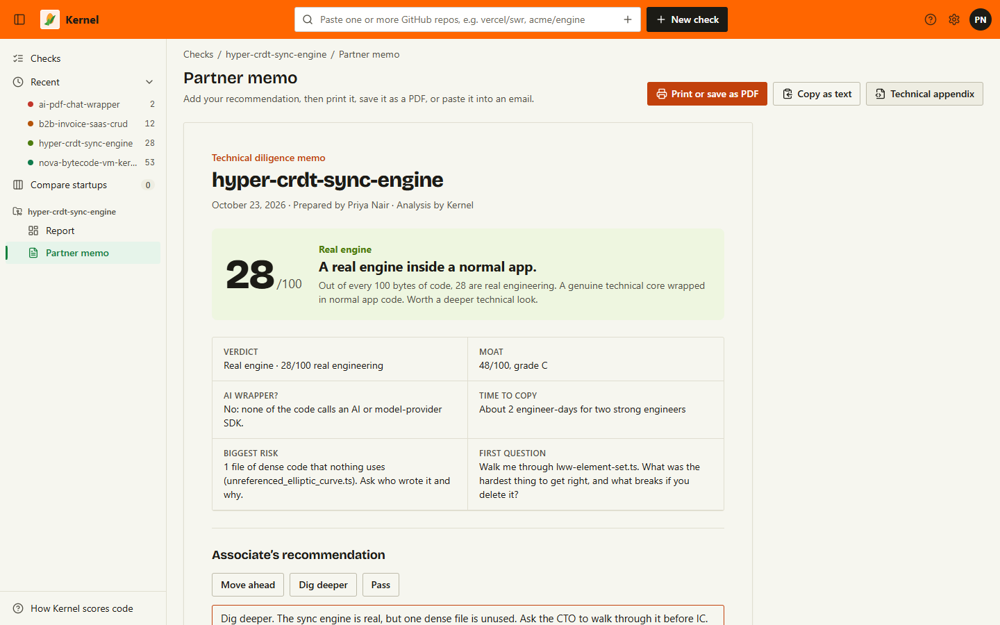
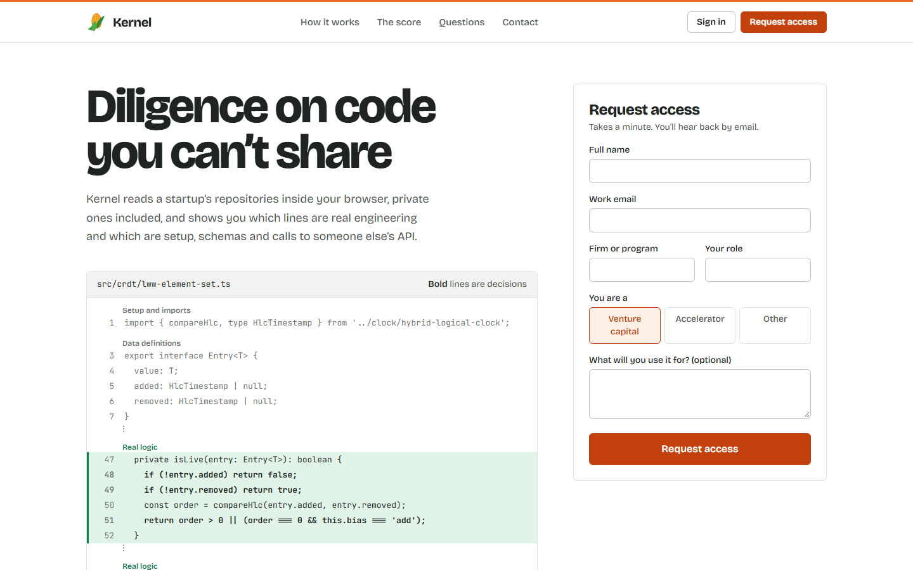
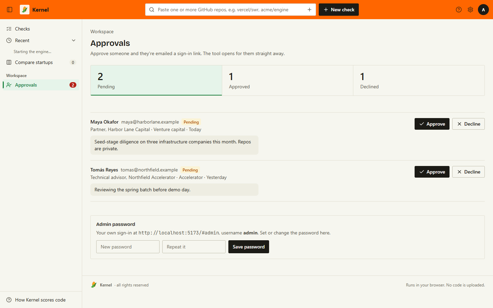
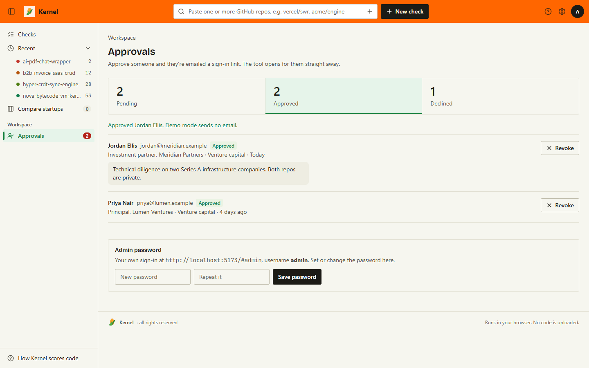

# Kernel

**Is this startup's code real engineering, or a wrapper? Ask your agent.**

Kernel is a technical due diligence tool for investors. It reads a startup's repository on your machine, private ones included, and tells you how much of it is real engineering and how much is scaffolding or calls to someone else's API: a score out of 100, a one-line verdict, the files where the real work lives, and the questions to put to the founders. A typical repo takes a few seconds. The code never leaves your machine.

## Install in Claude Code

```text
/plugin install kernel --marketplace marpusakethram/kernel
```

On older Claude Code versions, use two lines:

```text
/plugin marketplace add marpusakethram/kernel
/plugin install kernel@kernel
```

Then check it:

```text
/kernel:doctor
```

You should see `Kernel doctor: PASS`. Kernel needs **Node 18 or newer**, and nothing else: no API keys, no account, no server.

## Use it

Say to your agent:

- *"Audit github.com/acme/engine with Kernel."* or `/kernel:audit acme/engine`
- *"Who has the better engine: acme/engine or rival/engine?"* or `/kernel:compare acme/engine rival/engine`
- *"What should I ask the founders?"* or `/kernel:questions acme/engine`
- *"Write the IC memo on acme versus its competitors."* or `/kernel:memo acme/engine rival/engine`
- *"Show me what this file actually does."* or `/kernel:xray acme/engine src/core/solver.ts`

| Command | What you get |
| --- | --- |
| `/kernel:audit` | Verdict, Real Tech Score, Moat Score and grade, top engine files, red flags, founder questions |
| `/kernel:compare` | Head-to-head on IP strength and engine quality, metric by metric |
| `/kernel:questions` | Founder questions grounded in the actual code |
| `/kernel:memo` | A one-page IC memo: proprietary vs rented, rebuild cost, risks, open questions |
| `/kernel:xray` | One file, line by line: real logic, layout, data definitions, API relays, setup |
| `/kernel:benchmarks` | Four built-in sample startups, one per verdict, to calibrate your eye |
| `/kernel:doctor` | Checks the install by scoring the samples and confirming the order |

A target can be `owner/repo`, a GitHub URL (including `/tree/<branch>`), a local folder, a `.zip` or `.tar.gz`, or `benchmark:<wrapper|saas|crdt|vm>`.

## Works with GBrain

If [GBrain](https://github.com/garrytan/gbrain) is connected to your agent, `/kernel:audit` and `/kernel:memo` file their results on the company's page in your brain: the verdict, scores, red flags and founder questions, dated. The next time you ask your agent about that company, the technical read is already there. There's nothing to configure, and without GBrain the commands work exactly the same.

## Private repos

Give Kernel a read-only GitHub token through its server's environment. In Claude Code, the simplest way is to start Claude Code with `GITHUB_TOKEN` set in your shell. Use a fine-grained token with read-only access to just the repos you're reviewing. The token is only ever sent to `api.github.com`, and repository contents are read into memory on your machine, never uploaded.

## What an answer looks like

This is a real result from one of the built-in samples:

```text
## hyper-crdt-sync-engine

Verdict: Real engine. A genuine technical core wrapped in normal app code.

Real Tech Score 28/100 · Moat Score 48/100 (grade C) · IP strength 46 · Engine quality 30

### IP & engine scorecard
| Metric              | Score | Detail                                 |
| Real Tech Score     |    28 | 28/100                                 |
| Engine size         |    26 | 4.15 KB · 4d to rebuild                |
| Vendor independence |   100 | no vendor SDKs                         |
| Integrity           |    75 | 1.35 KB of dense code is never used    |
| Engine depth        |    30 | 3 engine files                         |
| Test discipline     |     0 | no tests found                         |

### What we found
- The real work concentrates in 3 files, 95.2% of the real engineering.
- 1 isolated file (src/vendor_spoof/unreferenced_elliptic_curve.ts) is never used
  anywhere: 1.35 KB purged as potential spoofed or dead code.

### Questions to ask the founder
1. Walk me through lww-element-set.ts. What was the hardest thing to get right?
2. unreferenced_elliptic_curve.ts contains complex code that nothing else uses.
   Who wrote it, and why isn't it wired in?
3. There are no tests. How do you know it is correct?
4. A strong team could rebuild the core in about 4 engineer-days. What makes it harder?
```

(Abridged. In Claude Code, your agent turns this into the short answer the command asks for.)

## What the score means

The Real Tech Score is how many of every 100 bytes of code are real engineering. Use it to rank startups against each other.

| Score | Verdict | What it means |
| --- | --- | --- |
| 0 to 5 | **Wrapper** | Mostly glue and calls to someone else's API |
| 5 to 20 | **Standard app** | Normal product code with little original engineering |
| 20 to 50 | **Real engine** | A genuine technical core inside a normal app. Worth a deeper look |
| 50 to 100 | **Deep tech** | Dense, original logic that is expensive to reproduce |

Three things keep it honest:

- **Names are erased before scoring**, so renaming variables can't move the number.
- **Dropped-in code is flagged.** Clever code that nothing else in the product uses is called out and left out of the score.
- **Nothing is uploaded.** Analysis runs on your machine.

The score is a relative ranking, not an absolute grade, and one input to diligence rather than a verdict on a company. It is not investment advice.

---

## The hosted app, for your whole team

Not everyone lives in a terminal. The same engine runs in the browser at **https://kernel-diligence.vercel.app**, with access approved by hand. It checks repos in your browser tab (paste several at once), ranks them in a table, and turns any check into a one-page partner memo: the verdict at a glance, whether it's an AI wrapper, how fast it could be copied, strengths against risks, and the next diligence steps. Your checks and memo notes are saved to your account, and only scores and file names are saved, never the code. The Checks table works as a pipeline: filter by your Move ahead / Dig deeper / Pass decision, export to CSV, and see how a company's score moved since you last checked it. From a memo you can email the founder questions in one click, or share a read-only link with another approved partner.



| Checks | Report |
| --- | --- |
|  |  |

| Partner memo | Request access |
| --- | --- |
|  |  |

The owner approves requests in a queue, and approved people get a one-time sign-in link by email. Partners never need a password. The hosted app runs on React, Rails and Postgres.

| Approvals | After approving |
| --- | --- |
|  |  |

---

## Other agents: Claude Desktop, Cursor, Codex, Windsurf, Zed

Download **`kernel.zip`** from the [latest release](../../releases/latest) and unzip it anywhere, keeping the `mcp` and `public` folders together. Then point your client at the server:

```json
{
  "mcpServers": {
    "kernel": {
      "command": "node",
      "args": ["/ABSOLUTE/PATH/kernel/mcp/dist/kernel-mcp.mjs"],
      "env": { "GITHUB_TOKEN": "optional, for private repos" }
    }
  }
}
```

That goes in `claude_desktop_config.json` for Claude Desktop and `~/.cursor/mcp.json` for Cursor. For Codex, use `~/.codex/config.toml`:

```toml
[mcp_servers.kernel]
command = "node"
args = ["/ABSOLUTE/PATH/kernel/mcp/dist/kernel-mcp.mjs"]
```

On Windows, forward slashes work in the path, for example `C:/Tools/kernel/mcp/dist/kernel-mcp.mjs`. The server's tools are `audit_repository`, `compare_repositories`, `xray_file`, `founder_questions`, `run_benchmarks` and `explain_metrics`.

## What's here, and what's not

This repository holds the documentation, the screenshots and the packaged tool: a minified MCP server, the open-source tree-sitter language parsers it uses, and the Claude Code commands. **The source code is private.** The license lets you use Kernel for your own diligence, but not copy, modify, redistribute or reverse engineer it. Read [LICENSE](LICENSE).

## Contact

Kernel is built and run by Saketh.

- Email: [marpu.sr@gmail.com](mailto:marpu.sr@gmail.com)
- GitHub: [@marpusakethram](https://github.com/marpusakethram)
- Hosted app: [request access](https://kernel-diligence.vercel.app)
