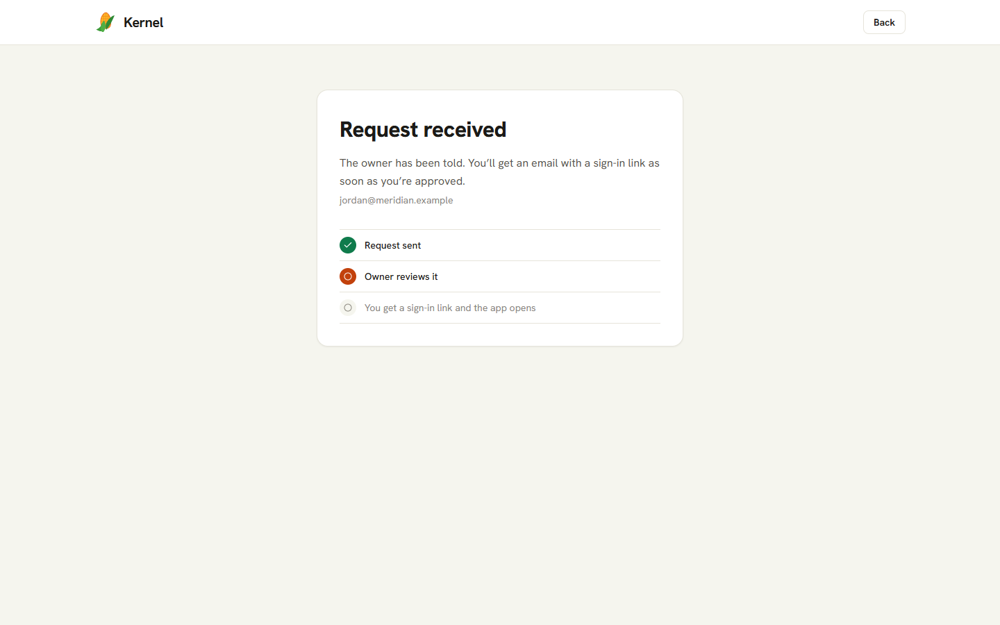
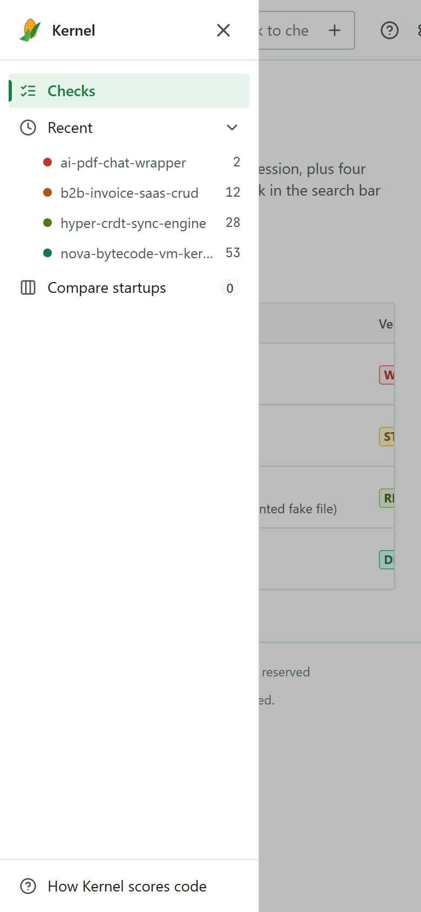

# Kernel

**Diligence on code you can't share.**

Kernel is a tool for investors and accelerators. It reads a startup's repositories inside your own browser or agent, private ones included, and scores how much of the code is real engineering and how much is scaffolding or calls to someone else's API. You get a score out of 100, a one-line verdict, and the exact files behind it. The code never leaves your machine.

**Use it:** https://kernel-diligence.vercel.app (access is approved by hand), or [add it to your AI agent](#add-kernel-to-your-agent).


This repository is the **showcase**: what Kernel does, how to use it, and how to add it to an agent. It is not the source code, which is private. See [what's here](#whats-here-and-whats-not).

---

## See it work

The whole user journey, from the first request to the verdict. This is the real tool checking one of its built-in sample repositories.


### 1. Request access

You send your name, firm and role. The owner reviews every request personally. When you're approved, you get an email with a one-time sign-in link, and there are no passwords.

| Request | Received |
| --- | --- |
|  |  |

### 2. Check a repo

Paste a GitHub link, or upload a folder or zip. Checked repos are listed as a table with a verdict, a score, and a moat grade.


### 3. Read the verdict

A plain-language verdict, the files where the real work lives, what looks dropped in, and the questions to put to the founders.


### 4. Hand partners a memo

Every check can become a one-page partner memo with your own recommendation on top. Print it, save it as a PDF, or paste it into an email.


### For the owner: approvals

New requests appear in a live queue with a count. Approving someone emails them their sign-in link.

| Queue | After approving |
| --- | --- |
|  |  |

It also works on a phone:



---

## What the score means

The Real Tech Score is how many of every 100 bytes of code are real engineering. Use it to rank startups against each other.

| Score | Verdict | What it means |
| --- | --- | --- |
| 0 to 5 | **Wrapper** | Mostly glue and calls to someone else's API |
| 5 to 20 | **Standard app** | Normal product code with little original engineering |
| 20 to 50 | **Real engine** | A genuine technical core inside a normal app. Worth a deeper look |
| 50 to 100 | **Deep tech** | Dense, original logic that is expensive to reproduce |

Three things keep it honest:

- **Names are erased before scoring**, so renaming variables can't move the number.
- **Dropped-in code is flagged.** Clever code that nothing else in the product uses is called out and left out of the score.
- **Nothing is uploaded.** Analysis runs on your machine.

The score is a relative ranking, not an absolute grade, and one input to diligence rather than a verdict on a company. It is not investment advice.

---

## Add Kernel to your agent

Kernel also runs as an [MCP](https://modelcontextprotocol.io) server, so your AI agent can audit a repo for you on your own machine. It needs **Node 18 or newer** and nothing else.

### 1. Download

Get **`kernel-mcp-v1.1.0.zip`** from the [Releases](../../releases/latest) page and unzip it anywhere. Keep the `mcp` and `public` folders next to each other: Kernel loads its language parsers from `public`.

Note the full path to `mcp/dist/kernel-mcp.mjs`. The examples below call it `/ABSOLUTE/PATH/kernel/mcp/dist/kernel-mcp.mjs`. On Windows, forward slashes work everywhere, for example `C:/Tools/kernel/mcp/dist/kernel-mcp.mjs`.

### 2. Add it to your client

**Claude Code**

```bash
claude mcp add kernel -- node "/ABSOLUTE/PATH/kernel/mcp/dist/kernel-mcp.mjs"
```

**Claude Desktop** (`claude_desktop_config.json`) and **Cursor** (`~/.cursor/mcp.json`)

```json
{
  "mcpServers": {
    "kernel": {
      "command": "node",
      "args": ["/ABSOLUTE/PATH/kernel/mcp/dist/kernel-mcp.mjs"]
    }
  }
}
```

**Codex** (`~/.codex/config.toml`)

```toml
[mcp_servers.kernel]
command = "node"
args = ["/ABSOLUTE/PATH/kernel/mcp/dist/kernel-mcp.mjs"]
```

Windsurf, Zed and other MCP clients use the same command and arguments in their own MCP settings. Restart the client after editing its config.

### 3. Ask it

> Audit `benchmark:crdt` with Kernel.

Kernel answers inside your agent. This is a real result, from a built-in sample repository:

```text
## hyper-crdt-sync-engine

Verdict: Real engine. A genuine technical core wrapped in normal app code.

Real Tech Score 28/100 · Moat Score 48/100 (grade C) · IP strength 46 · Engine quality 30

### IP & engine scorecard
| Metric              | Score | Detail                                 |
| Real Tech Score     |    28 | 28/100                                 |
| Engine size         |    26 | 4.15 KB · 4d to rebuild                |
| Vendor independence |   100 | no vendor SDKs                         |
| Integrity           |    75 | 1.35 KB of dense code is never used    |
| Engine depth        |    30 | 3 engine files                         |
| Test discipline     |     0 | no tests found                         |

### What we found
- The real work concentrates in 3 files, 95.2% of the real engineering.
- 1 isolated file (src/vendor_spoof/unreferenced_elliptic_curve.ts) is never used
  anywhere: 1.35 KB purged as potential spoofed or dead code.

### Questions to ask the founder
1. Walk me through lww-element-set.ts. What was the hardest thing to get right?
2. unreferenced_elliptic_curve.ts contains complex code that nothing else uses.
   Who wrote it, and why isn't it wired in?
3. There are no tests. How do you know it is correct?
4. A strong team could rebuild the core in about 4 engineer-days. What makes it harder?
```

(Abridged. The full result also lists the top engine files and more.)

### What you can ask for

| Tool | What it does |
| --- | --- |
| `audit_repository` | Verdict, score, moat grade, top engine files, red flags and founder questions |
| `compare_repositories` | Head-to-head on IP strength and engine quality, metric by metric |
| `xray_file` | One file, line by line: real logic, layout, data definitions, API relays, setup, comments |
| `founder_questions` | Questions grounded in the actual code, for the founder meeting |
| `run_benchmarks` | Score four built-in sample startups to see what each verdict looks like |
| `explain_metrics` | Plain-language definitions of every number Kernel reports |

A target can be `owner/repo`, a GitHub URL (including `/tree/<branch>`), a local folder, a `.zip` or `.tar.gz`, or `benchmark:<wrapper|saas|crdt|vm>` for the samples.

### Private repositories

Set a read-only GitHub token in the server's environment:

```bash
claude mcp add --transport stdio --env GITHUB_TOKEN=your_token_here kernel -- node "/ABSOLUTE/PATH/kernel/mcp/dist/kernel-mcp.mjs"
```

In other clients, add an `env` block next to `command` and `args`: `"env": { "GITHUB_TOKEN": "your_token_here" }`.

The token is only ever sent to `api.github.com`. Repository contents are read into memory on your machine and are not uploaded anywhere. Use a fine-grained token with read-only access to just the repos you're reviewing.

---

## Privacy and security

- **Your code stays on your machine.** The hosted tool analyzes in your browser tab. The MCP server analyzes on your computer.
- **The token is yours alone.** In the hosted tool it lives in that browser tab and is cleared when you close it.
- **Access is by approval.** One request per email, reviewed by hand. Sign-in is a one-time emailed link, with no password to leak. Approval is checked live, so revoking someone locks them out right away.
- **The site stores your access request and sign-in email**, and nothing about the code you check.

---

## What's here, and what's not

This repository holds documentation and screenshots. The packaged MCP server is in the [Releases](../../releases). **The source code is private**, and the license lets you use Kernel but not copy, modify, redistribute or reverse engineer it. Read [LICENSE](LICENSE).

## Contact

Kernel is built and run by Saketh.

- Email: [marpu.sr@gmail.com](mailto:marpu.sr@gmail.com)
- GitHub: [@marpusakethram](https://github.com/marpusakethram)
- To use the hosted tool: [request access](https://kernel-diligence.vercel.app)
